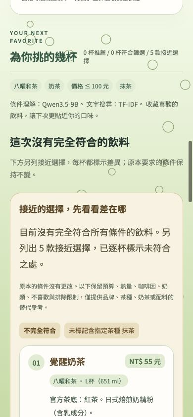

# 3.1.10 條件過嚴時的接近選擇

## 需求與行為

手動與對話推薦保留原本完全符合的結果、原始條件與狀態。完全符合少於5款時，另外列出「接近的選擇」，以合計5款為目標（不超過請求limit）。這些選擇不算完全符合，逐杯明示差異；不會為了湊數捏造飲料或隱藏超標。

可以作替代參考的正向偏好僅限：指定品牌、茶種、想喝奶茶、想要配料。先依差異加權少者排序（換品牌成本3，其餘1），相同差異再用TF-IDF文字相近度排序；因此優先保留同品牌的接近飲料。這不是Qwen／RelGT的新模型排序，也不是機率。

保持不變的限制：預算、熱量、咖啡因上限及嚴格不等號；奶類（含無奶與植物奶）、不喝奶茶、排除品牌／配料、個人不喜歡、已看過品項。數值未知或估算仍依現有硬篩選排除。過敏／忌口、原本已阻擋或待釐清要求不提供替代；不足5款就顯示實際數量及自行調整的提醒，不自行提高上限。

例如指定品牌與奶茶無交集時，頂部說明沒有完全符合的飲料，下面可以出現該品牌其他類別，明示「這杯不是奶茶」。使用者圖片的八曜例子為假設：目前目錄其實有八曜奶茶，因此不能硬說沒有。正式驗證使用確實無交集的「八曜和茶＋抹茶＋奶茶＋100元內」。

## 實作

- `worker/alternatives.ts`：額外候選以品牌／同名合併杯型，與完全符合結果去重；每組只保留差異相同且符合實際條件的可選版本。預設選該組最低價版本。原始filters不變，替代項另有actualFilters與deviations；每一版本都經既有consumerContract核對。
- 回傳`alternatives`與`alternativeNotice`，原始`results`與其硬篩選契約維持。回饋與換批仍按商品合併，替代項已顯示ID也加入換批排除。
- 手動與對話使用共用獨立區塊，保留原始條件標籤、逐杯黃色差異標示。對話助手會交代完全符合數量及另列接近數量。選擇杯型時外層差異提示仍保留。
- 團隊後台把完全符合與接近項分開顯示，紀錄保存實際替代內容。資料庫result_count仍是完全符合數量，避免把替代當成符合。
- 沒有改動Qwen、RoBERTa、RelGT權重、每日訓練或週更排程。

## 驗證

型別與JavaScript語法檢查通過；Node121項，104通過、17個環境條件略過。新增5項功能測試：零符合補5款、硬限制與否定不可放寬、阻擋／釐清不補、部分符合及跨杯型換批去重、篡改實際條件／隱藏差異時拒絕。

隔離本機D1／Worker實際HTTP：八曜抹茶奶茶零符合、另列5款；換批商品不重複；0元預算不提高、過敏阻擋；對話保留既有抹茶條件時零符合另列5款。測試中也確認沒有抹茶結構條件時八曜奶茶有正常符合結果，不捏造品牌無品項。

正式站已部署3.1.10，Worker `0d5c7445-ab92-4e4d-a97b-e6e63be42cca`，既有週更Cron不變。健康版本與8個靜態資產雜湊一致；正式HTTP驗證零符合另列5款、0元不提高、過敏阻擋、換批不重複及對話保留狀態的替代結果通過。團隊紀錄中的原條件、完全符合與接近項均與實際API回傳一致。安全摘要見 [線上驗證](3.1.10接近選擇線上驗證.json)。

正式站手動輸入奶茶並選八曜／抹茶／100元，畫面實際顯示Qwen3.5-9B解析及0款完全符合、5款接近；每款均標示未含指定抹茶。替代排序仍為本機條件差異＋TF-IDF，不把Qwen解析當作替代排序模型。390px手機版無橫向溢出，差異與說明正常呈現。三模型權重版本未變且均ready。

Git提交、CI與Release完成後另補記。

