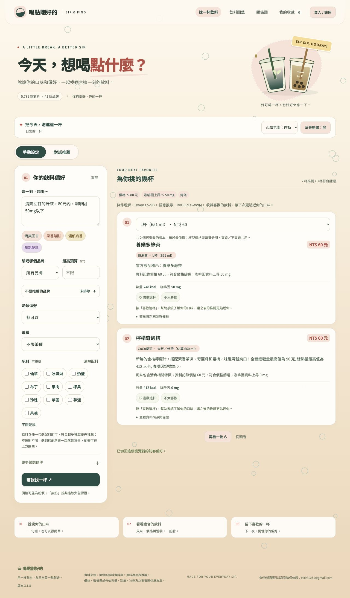

# 3.1.8 手動搜尋接入 Qwen

## 行為

手動模式的非空文字會送到既有 Mac Qwen3.5-9B 解析服務，使用與對話模式相同的結構驗證與目錄欄位。空白文字、只操作表單時不呼叫 Qwen；不建立聊天歷史。Qwen 理解條件後，仍由網站硬篩選、RoBERTa／TF-IDF 與個人化排序產生飲料結果，模型不能捏造飲料資料。

表單已選的品牌、奶類、茶種與排除條件保留，數值上限取較嚴格者。只接受能由原句核對的模型數值。「比較沒負擔的，熱量低一點」仍須補充 kcal 上限；「近乎為零」不能被擅自解讀成 0 mg。過敏與不支援的限制維持阻擋。

模型無法使用或回傳格式不合時，保留規則解析結果並顯示備援狀態。畫面分開標示 Qwen 條件理解與 RoBERTa／TF-IDF 搜尋，團隊後台保存原始手動請求、解析來源及實際顯示的釐清文字。成功推薦仍直接顯示飲料卡片，不偽造聊天回覆。

## 驗證

- TypeScript 檢查通過；完整 Node 測試 111 個，94 通過、17 個需特定環境的既有測試略過。
- 新增 5 個單元測試，涵蓋口味改寫與表單限制、混合數值、含糊條件、限制不能消失、無效模型輸出與手動重設詞。
- 隔離本機 D1／Worker 實際 HTTP：無模型備援、純表單不呼叫模型、WebSocket 模擬 Qwen 解析、上限取嚴格值、零咖啡因所有可選杯型、含糊熱量釐清、排除奶茶、過敏阻擋通過。模擬輸出只用來驗證接線與防護，不代表真實模型準確度。
- 未訓練或替換模型權重，沒有把測試結果當作使用者滿意度改善證據。

## 發布

正式站已部署 3.1.8，Worker `562c0d08-cd2d-40f2-b4ae-a736e54232e2`。線上 API 與靜態資產一致；真實 Qwen3.5-9B intent-v7 的口味、混合數值、表單上限、所有杯型、含糊熱量釐清、排除奶茶、純表單免呼叫，以及後台保存解析來源和釐清文字皆通過。Qwen、RoBERTa、RelGT 均 ready。詳見 [安全驗證摘要](3.1.8手動千問線上驗證.json)。

首次真實推論約 27.9 秒，超過既有橋接 20 秒限制，該次正確使用規則備援；暖機後重測通過。另「比較不膩」及只說排除奶茶時模型可能詢問偏好，不能把合法釐清誤報為接線失敗，也不能把無結果說成成功推薦。這次未更動逾時或常駐服務。

發布提交 `599bbf39648feefa10a7b6f573b36f8aa17c2afb` 已推送 main，遠端提交一致；CI [38865172560](https://github.com/AIbot1031/drinks_mk2/actions/runs/38865172560) 全部成功。tag `v3.1.8` 指向該已驗證提交，[GitHub Release](https://github.com/AIbot1031/drinks_mk2/releases/tag/v3.1.8) 已建立，Latest 與正式站同為 3.1.8。未提交用戶既有 ZIP、先前訓練報告、金鑰或權重。

