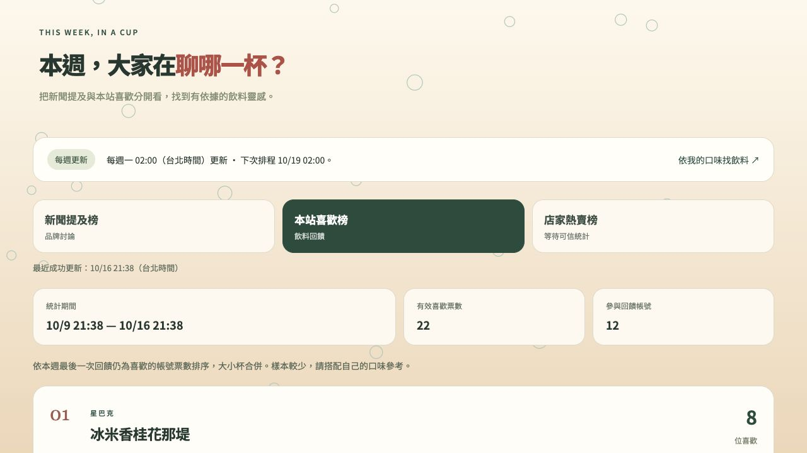
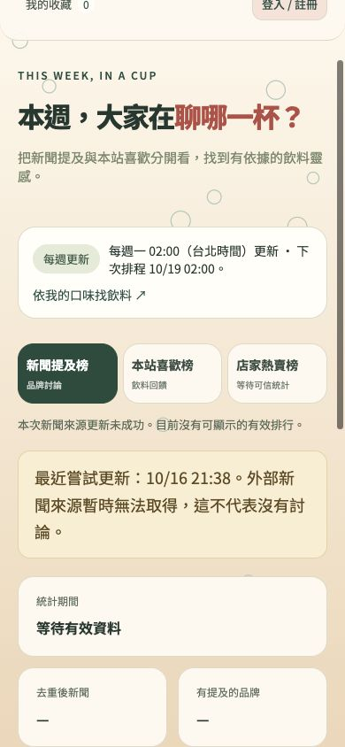

# 3.1.9 本週熱門

新增 `/#trends` 本週熱門頁面與主導覽入口，提供新聞提及、本站喜歡、店家熱賣三種來源的分開檢視。

## 已實作

- 公開讀取 `GET /api/trends`，從 D1 已保存快照顯示統計期間、樣本數、最近成功更新、更新失敗與過期狀態；公開請求不觸發外部抓取。
- 新聞榜採 GDELT DOC 2.0，固定查詢 `"bubble tea" sourcecountry:Taiwan`、最近七天、最多250篇。只計回傳新聞標題中完整目錄品牌名稱的提及，按篇數排序，附原報導網域、索引時間與網址。只保留統計和出處，不存新聞全文、照片或標題。去除追蹤參數、同網址及相同正規化標題；不同標題轉載仍可能重複。此榜僅反映該查詢已收錄新聞，不代表全網聲量、正評、銷量或單杯人氣。來源封頂會明示。
- 本站榜：每帳號每品牌同名飲料、大小杯合併；只取七天內最後一次操作，最後為 like 才計一票。取消、改不喜歡會移除；同票並列，不公開帳號或原始事件。這是本週新增回饋統計，不是所有收藏累計；可能含測試操作，樣本少只供參考。上限10000事件，超過則該次失敗，不默默用部分資料排名。
- 店家榜尚無具期間／範圍的可信銷量統計，明確顯示未接入，不把品牌招牌當銷售第一。
- 每週一02:00 Asia/Taipei，Cloudflare Cron `0 18 * * SUN`；獨立於每日模型訓練與Mac開機。部署排程不代表未來已實際跑過。
- `POST /api/trends/refresh` 受既有 SEMANTIC_KEY bearer 保護；D1租約避免重疊與連續刷新。固定外部端點、20秒逾時、2MB輸入上限。新聞與本站分開處理，單一來源失敗不取消另一來源成功結果。失敗保留最近成功資料，超過八天標示過期，首次無資料不編造名次。
- 有相鄰一週的成功快照才顯示名次差；初次或上期缺漏寫無法比較。未接入Qwen排行意圖處理，亦未將熱門度加入個人推薦排序或模型訓練。

## 驗證

型別檢查通過；Node116項：99通過、17項環境條件略過。新增測試涵蓋台北週一排程、新聞去重、期間和不安全網址、來源格式及封頂、同帳號跨杯型的喜歡／取消／不喜歡、平手與未知上期名次。隔離本機D1／Worker HTTP驗證公開讀取、未授權刷新401、本站獨立成功、外部失敗狀態通過。沒有在正式庫加入模擬互動或模擬新聞。

## 來源依據及限制

[GDELT DOC 2.0官方文件](https://blog.gdeltproject.org/gdelt-doc-2-0-api-debuts/)提供JSON查詢與資料視覺化用途；[Cloudflare Cron文件](https://developers.cloudflare.com/workers/configuration/cron-triggers/)說明UTC排程及傳播延遲。Google新聞RSS限制用途，未採用其內容建立公開榜單。

外部GDELT在本機查詢回傳限流訊息；不得把它當成零新聞或成功更新。本版優先完成可驗證的頁面、本站聚合與週更管線，新聞實際狀態以正式刷新結果為準。

## 發布

正式站已部署3.1.9，Worker `4e01b130-fc3e-4a2d-8de4-55a9a10fad8f`，遠端migration0006完成；部署輸出確認每週Cron。API健康版本與index/app/styles/trends資產雜湊一致。首次正式手動刷新：本站成功，12個參與帳號、22張有效票、14款飲料；新聞失敗且未產生排行。這次是實際手動初始化，不是宣稱排程已在未來執行。安全摘要見 [線上驗證](3.1.9本週熱門線上驗證.json)。

正式站桌面驗證本站票數、並列名次與無上期比較；390px手機驗證新聞失敗狀態與無橫向溢出。另在隔離本機注入明確合成的十天前新聞快照，刷新失敗後仍保留原內容並標示過期；未注入正式庫。

發布提交 `69d0d15f55e72c8dcc8165fc6196cf80b20136b7` 已推送main並核對遠端一致；[CI 38909672732](https://github.com/AIbot1031/drinks_mk2/actions/runs/38909672732)全成功。tag `v3.1.9` 指向已驗證發布提交，[GitHub Release](https://github.com/AIbot1031/drinks_mk2/releases/tag/v3.1.9)已建立，Latest與正式站同為3.1.9。既有未追蹤訓練報告及ZIP未納入，未提交憑證、原始互動或權重。

