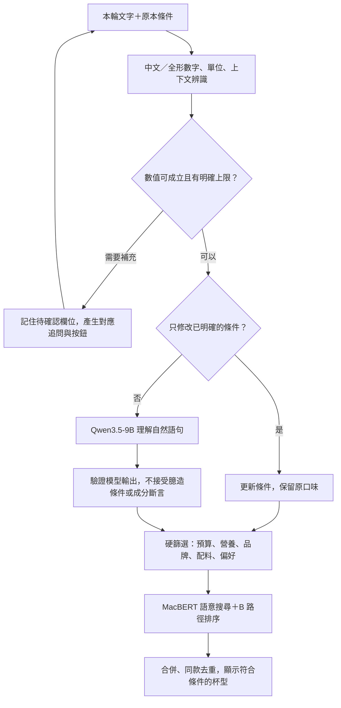

# 對話輸入與數值追問修正

2026-10-14，Asia/Taipei。這次修正網站的解析與對話管理程式，沒有訓練、更換模型權重或修改 Qwen 提示。Qwen 仍為 `qwen3.5-9b-4bit-8b2b98c00a6b-intent-v7`。

使用者輸入「咖啡因少於零」時，原本會變成「想喝清爽茶類還是濃郁奶茶」的無關追問。根因有三個：規則缺少中文數字及「少於」，後端會阻擋含營養斷言的模型文案，替代文案又沒有記住要問哪個條件。現在數值問題由已驗證的欄位產生追問，不直接展示模型編造的商品或成分事實。

## 現在可以怎麼說

| 說法 | 行為 |
| --- | --- |
| 咖啡因少於零 | 說明無法成立、追問咖啡因上限，先不推薦 |
| 接著回「零」或「五十以下」 | 接續剛才的咖啡因追問，保留口味、預算、品牌及配料排除 |
| 預算八十、五十塊錢以內、預算提高到一百二十 | 理解中文數字並修改預算，保留原口味 |
| 咖啡因０．０５ｇ | 將完整公克數值換成每杯 50 mg 上限 |
| 咖啡因少於五十 | 嚴格小於 50 mg，等於 50 的版本不通過 |
| 咖啡因五十以下 | 小於或等於 50 mg |
| 再便宜一點 | 問希望每杯最多多少元，不自行選一個降價幅度 |
| 咖啡因不限、取消咖啡因限制 | 只解除咖啡因上限 |
| 奶茶不要珍珠和布丁 | 同時排除兩種配料，不把布丁當成正向需求 |

咖啡因追問提供「零咖啡因／50 mg 以下／咖啡因不限」按鈕。按鈕送出完整欄位名稱；即使點到前一輪按鈕，也不會把數字誤套到另一個欄位。直接鍵入簡短回答時，以目前第一個待確認欄位接續。有多個無效數值時逐一確認；「再推薦幾杯」不會跳過尚未釐清的限制。

## 流程與程式位置

- `worker/numeric-language.ts`：數字、單位、比較、明確解除、簡短回答與安全追問。
- `worker/conversation.ts`：保留口味，更新 `pendingCaps`，逐欄釐清；不清除既有過敏限制。
- `worker/llm-conversation.ts`：模型數值須符合使用者明確表達；不能把已確認的數值編輯改回口味追問。
- `worker/understand.ts` 與 `worker/recommend.ts`：手動查詢／對話／兩路候選共用比較規則；`priceExclusive`、`caloriesExclusive`、`caffeineExclusive` 控制嚴格小於。
- `worker/index.ts`：待釐清時不送候選排序；明確修改已知條件直接處理，`chatModel` 如實為 null；複合自然語句仍交給 Qwen。
- `public/chat.js`、`public/styles.css`：快捷回答、待確認標籤、`<`／`≤` 正確顯示與狀態文案。

這次沒有讓 Qwen 任意改篩選器。Qwen 仍處理一般口味與複合自然語句；數值的有效性、硬篩選與回覆是否符合已知條件，由程式把關。明確修改條件不必等待 Qwen 生成，模型離線時也可以完成數值追問與回答。

## 同方法比較及驗證

比較的是人工合成的網站對話情境，沒有把它們宣稱為真實顧客對話、模型訓練資料或推薦滿意度指標。

| 相同驗證項目 | 更新前正式網站 | 更新後正式網站 |
| --- | ---: | ---: |
| 與咖啡因相關的無效值追問 | 不通過 | 通過 |
| 回答「零」接續咖啡因 | 不通過 | 通過 |
| 中文預算且保留茶類 | 不通過 | 通過 |
| 中文咖啡因上限且保留茶類 | 不通過 | 通過 |
| 嚴格小於咖啡因上限 | 不通過 | 通過 |
| 便宜一點追問預算且保留口味 | 不通過 | 通過 |
| 負數不得當成正數套用 | 通過 | 通過 |
| 同時排除珍珠與布丁 | 不通過 | 通過 |
| **合計** | **1／8** | **8／8** |

正式站驗證均為訪客合成請求，未建立正式測試帳號或寫入喜歡／不喜歡事件。舊版前測與新版後測使用同一支程式、同一判準；通過數差值 +7。前測執行時間與每項輸出保留在 JSON；時間只是這次請求的測量，不是一般效能保證。

本機 62 項測試全部通過、0 略過，包含真實本機 Worker HTTP、帳號隔離、角色權限、偏好合併、候選篩選及新數值對話。最後調整按鈕的完整欄位訊息後，數值對話 9 項再次通過。型別、JS 語法、build、Wrangler dry-run、diff 格式檢查通過。

另將既有 Qwen3.5 驗證的 21＋8 份快取輸出送進新 Worker 合併程式：網站契約維持 21／21、8／8，沒有退步。這是重播既有輸出，不是重新生成、不代表重新評估或改善 Qwen 原始模型。初次重播因新增多餘的 `false` 比較欄位造成舊契約比對不一致，已改為省略未使用欄位；首次結果保留在忽略 Git 的 `.wrangler/conversation-upgrade/regression-*/first-score.json`。

瀏覽器使用獨立 localhost 訪客測試：茶類＋預算一百＋不加珍珠→咖啡因少於零→點零咖啡因，保留三個原條件，改成咖啡因 0 mg。追問與快捷按鈕畫面：`docs/screenshots/對話數值追問驗證.png`；圖片為本機合成情境，並非使用者原始畫面。

完整安全比較：`docs/對話輸入修正線上驗證.json`。

## 部署與回復

已發布 Worker `185a8c27-56a8-40a6-8daa-ad1b755530e7`。舊版 `26ab12af-e1bc-406a-81e8-656b90da1eb2` 保留，可使用 Wrangler rollback 回復。沒有改 D1 schema、目錄、模型權重或排程；模型訓練 optimizer 步數為 0，Git 未 commit／push。

Qwen3.5-9B、MacBERT、RelGT 均 connected／ready，目錄版本維持 `6aa67407a66b04c496e2cfa80800a66857a74d13f842f8b8c03b04ae61205bab`。這輪訪客驗證沒有要求 RelGT 做帶用戶歷史的排序，不能把 ready 當成已重測 RelGT 推論品質。

重新整理既有頁面以載入新按鈕及比較標籤。若回復舊 Worker，亦須重新整理清除新格式的待確認狀態。

## 仍有的限制

- 模糊數值、範圍、下限、百分比、每毫升含量、kJ 等目前追問上限，不假裝已套用；「一百二」可能有不同解讀，請改成完整「一百二十」或阿拉伯數字。
- 無資料及估算營養不當作零，零咖啡因仍依資料庫記錄篩選，不新增成分安全保證。
- 「再便宜一點」目前追問明確預算；尚未建立比較上一輪各杯價格的排序功能。
- 修改甜度、冷熱等缺少目錄規則的需求仍會提示未驗證。開放式口味理解仍可能需要追問；這次 8 組合成檢查不代表所有語句都能理解。
