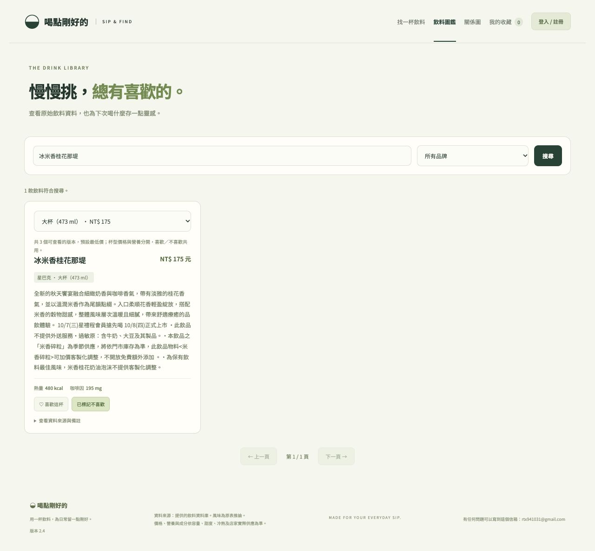

# 杯型喜歡／不喜歡共用

2026-10-14 已部署。偏好以「同品牌＋同品名」為一款飲料，大杯、小杯及同品項地區版本共用；不同品牌的同名飲料仍分開。杯型價格、容量及營養維持各自資料。

問題原因：收藏卡片原先已按品名合併，但不喜歡按鈕及推薦篩選仍只比較單一杯型 ID，所以其他杯型能再次進榜。

現在的行為：

- 在任何杯型按不喜歡，A／B 候選、融合結果及所有顯示杯型都排除整個品項；重新查詢、重新整理仍適用。
- 喜歡只算一款、只提供一個收藏圖種子。切換杯型會顯示共同狀態；在其他杯型取消偏好也會取消整款。
- 明確改按喜歡會清除同品項所有不喜歡紀錄，改按不喜歡會清除收藏，兩者互斥。
- 舊資料若同款不同杯型同時有喜歡和不喜歡，沒有可靠的先後資訊時以不喜歡優先；重新按喜歡即可改變偏好。

`worker/products.ts` 共用產品辨識與偏好正規化。帳號 GET／推薦讀取會按品項解讀舊紀錄，不需刪掉偏好重建；下一次 PUT 儲存每款的共同代表 ID。訪客沿用原 localStorage 鍵，讀取後由 `/api/catalog/preferences` 取得同品項資料；新版偏好格式為 version 2，仍接受 version 1 匯入。新按鈕保存一份品項偏好及品牌／品名摘要，之後送出任何杯型 ID 都會依同一品項解讀。

`worker/interactions.ts` 在原 D1 batch 交易內，先將舊／新 ID 轉成相同品項再比較。單純將大杯 ID 換成小杯代表 ID、合併既有重複杯型及重試不會製造新事件；真正喜好改變按每品項、每個狀態記一次變化，不把所有杯型展開成多次互動。保留舊事件及真實時間，沒有回填歷史。現有 RelGT 訓練資料適配已按品牌／品名合併商品，這次未重訓或替換模型。

## 驗證

53 項網站、前端偏好函式及 SQLite 事件測試全部通過，0 略過；包括真正本機 Worker HTTP、帳號保存／重新讀取、跨杯型互斥、全目錄 2,603 品項正規化、A/B 惡意分數不能恢復被排除的杯型、單一圖種子、事件去重及交易回滾。型別、JS 語法、diff 檢查、build／Wrangler dry-run 通過；最後收緊偏好 API 的 JSON 物件驗證後，帳號／偏好／事件 7 項重測通過。

第一個新增單測誤把仍使用 RelGT 的 mock 回覆要求為 personalized=false，已改為檢查被排除品項沒有收藏種子；此為測試假設修正，沒有更動 RelGT 分類。第一個線上探測也誤假設事先指定飲料一定進前六名，改以真正當次第一名測試，不更動排序來迎合測試。

瀏覽器本機實測：在中杯按不喜歡，切大杯、重新整理後切特大杯仍標記；跨杯型改按喜歡後全部杯型收藏，收藏數為 1、不喜歡取消。測試使用獨立 localhost 埠與合成訪客偏好，已清除測試偏好並關閉頁面。

正式網站另外確認：當次第一名「星巴克／可可瑪奇朵」有 3 種杯型，傳任一杯型不喜歡後，新請求、再次新請求及 Qwen 對話推薦都排除整個品項，其他符合條件飲料仍有 6 款。確認喜歡多杯型只算一款、舊矛盾紀錄以不喜歡優先、前端新模組可讀及三模型 ready。安全彙總：[線上驗證 JSON](杯型偏好共用線上驗證.json)。沒有在正式站建立測試帳號或記錄顧客身份。

## 部署與限制

網站 Worker version：`26ab12af-e1bc-406a-81e8-656b90da1eb2`，前一版為 `6386c939-a8b1-4672-866b-daef3688a1dd`。沒有修改 D1 schema、批次重寫所有用戶偏好或刪除歷史事件。Qwen3.5-9B intent-v7、MacBERT 與 RelGT 的模型權重、目錄及排程均未變，本次訓練步數 0。

已開啟的舊頁面需重新整理一次來載入新按鈕邏輯。品項以目前目錄的精確品牌／品名為準，名稱不同的飲料不自行猜測成同款；已不在目錄中的未知 ID 無法還原品項。訪客仍只保存於目前瀏覽器，跨裝置需登入帳號。

本次未 Git commit／push，保留先前未提交工作及使用者 ZIP；沒有將金鑰、顧客資料或原始互動寫入文件／Git。
