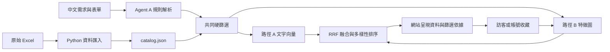

# 系統架構與目前進度

## 本階段決定

部署使用 Cloudflare Workers 與 Static Assets。GitHub 保存程式、來源資料與說明文件。參考使用者提供的推薦網站的偏好表單、收藏、換批與關係圖流程，新增飲料圖鑑、營養限制及本機偏好匯出／匯入。

路徑 C（SASRec／BST）與 Agent C（RAG／LLM 推薦解釋）都不實作。Cloudflare Workers AI 不使用。Agent A 的外部大模型供應商之後再決定。

## 已可使用的第一版

| 架構部分 | 第一版實作 | 與原架構的差異 |
| --- | --- | --- |
| Agent A：理解需求 | 規則解析常見中文偏好、預算、營養上限、奶類、茶種與配料；整合表單條件。 | 尚未呼叫大模型，不能保證理解所有自然語言；未知或不支援的排除條件會提示。 |
| 安全條件 | 指定品牌、排除品牌、價格、茶種、奶類、配料、熱量、咖啡因硬篩選；有上限時排除未知值；過敏／忌口查詢停止推薦。 | 不將未命中的成分標記當成安全證明。價格若為起價，只能驗證資料中的起價。 |
| 路徑 A | 中文字元二元片段與風味同義概念的 TF-IDF 向量、餘弦相似度搜尋。保留原始 Chroma Python 原型。 | 網站版不運行 Python／Chroma；目前是可離線運算的文字向量基線，尚未使用神經語意 embedding、BGE-M3 或 Vectorize。 |
| 路徑 B | 飲料↔品牌／茶種／奶類／配料／風味特徵圖，以收藏或查詢候選作起點，進行三次圖傳播。 | 這是個人化隨機遊走基線，尚未接入正式 RelGT、LightGCN 或 Two-Tower 偏好模型。RelGT 目錄價格回歸已完成本機驗證，沒有發布線上。沒有全站使用者互動資料，不能宣稱已完成協同訓練。 |
| 融合與排序 | 各路徑取前 100 候選，以加權 RRF 融合：A 權重 0.65、B 權重 0.35，常數 60；優先增加品牌多樣性。 | 目前為固定權重，尚未完成 Learning-to-Rank 訓練。 |
| 結果驗證 | 兩條路徑使用相同合格資料池；輸入型別、資料缺值、排除與換批有測試。 | 程式規則驗證，未建立另一個大模型 Validation Agent。 |
| 結果呈現 | 顯示飲料資料、風味、價格、營養、實際套用條件、資料來源與固定規則依據。 | 不設 Agent C，不呼叫大模型產生推薦解釋。排序分數不是推薦正確率。 |
| 回饋 | 喜歡／不喜歡、個人收藏；訪客儲存在 localStorage；登入後保存 D1 帳號偏好，可匯出／匯入 JSON。 | 用戶可註冊、登入與跨裝置讀取收藏；不是已訓練的協同模型。 |

## 資料流程

## 之後怎麼接 Agent A 大模型

推薦 API 的輸入契約維持 `query` 與 `filters`，條件以 `worker/types.ts` 定義。未來可在 `worker/understand.ts` 旁增加供應商轉接器，請大模型輸出相同結構，經 `validateInput` 與來源資料核對後才進入推薦。API Key 存放在 Cloudflare secrets，不能放在前端、GitHub 或聊天裡。

大模型解析不可放寬表單上限、覆蓋未知過敏原狀態或直接新增飲料。呼叫失敗時回到規則解析並揭露備援狀態。供應商、模型、費用與是否儲存輸入都還未決定；本版沒有預設 API Key，也不發送資料給外部大模型。

## 資料注意事項

目前使用新版「飲料品項」5,781 筆杯型／地區紀錄、41 個品牌。主數值包含估算（價格 600、熱量 2,535、咖啡因 2,972），估算值不能用來通過硬上限；咖啡因只採明確上下限欄，3,232 筆上界未知。過敏原 0 不表示無過敏原。

過敏原 I 至 O 欄全部使用重複表頭，七欄的實際含義都待核對。本版不將這些欄位用作成分安全篩選。茶種與奶類沿用原表標記，配料僅從名稱的明確關鍵字取得；「未標記」不代表確認不含。風味為原表推論，營養與價格有容量、冷熱、甜度等適用範圍。

## 驗證與部署

`npm test` 驗證核心限制、缺值、過敏阻擋、收藏圖、換批與輸入檢查。`TEST_BASE_URL=http://localhost:8787 npm test` 額外在真實本機 Workers runtime 驗證 API。`npm run check` 檢查 TypeScript。`npm run deploy:check` 檢查 Cloudflare 打包。GitHub Actions 執行型別、測試及部署 dry-run，不自動部署。

上線網站使用獨立 `drinks-mk2` Worker，不修改參考站。飲料資料與消費者推薦介面為公開；GitHub 倉庫保持私人。這是第一版可操作基線，非所有訓練模型的完成版。

消費者可自行註冊與登入帳號，詳見[用戶登入與收藏](用戶登入與收藏.md)；另有獨立團隊 ID／密碼保護的內部檢查頁。每次有效推薦在 D1 保存 A/B、權重與最後輸出，詳見[推薦過程與團隊檢查](推薦過程與團隊檢查.md)。使用者已提供官方 RelGT 程式與論文，後續移植與本機訓練規劃見[RelGT 本機訓練規劃](RelGT本機訓練規劃.md)。

## 查閱來源

- [使用者提供的介面參考](https://drink-recommendation-relgt.rtx941031.workers.dev/)
- [Cloudflare Workers Static Assets](https://developers.cloudflare.com/workers/static-assets/)
- [Cloudflare Wrangler 配置](https://developers.cloudflare.com/workers/wrangler/configuration/)
