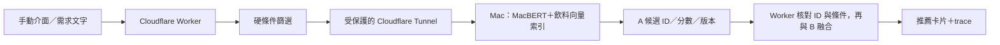

# 雙介面與 MacBERT 推論服務規劃

更新：2026-10-13（Asia/Taipei）

## 已完成的雙介面

推薦頁可切換「手動設定」與「對話推薦」。手動表單保留所有原功能；對話版用文字調整本輪條件，包含預算上調／下調、品牌排除、奶類變更、再看一批及重新開始。兩邊共用目錄、硬篩選、收藏與帳號。

目前對話解析由規則完成，沒有 LLM。使用者已明確指定暫時不接對話 LLM，也不使用 Cloudflare Workers AI。路徑 C 與 Agent C 仍不加入。

- `/api/chat/recommend`：接收當則 message、上輪 state 與換批排除；伺服器重新驗證條件。
- 上輪數字限制不拼回查詢文字，才能將預算從 50 改成 80，而不是被舊的 50 限制住。
- 只有可辨識的品牌排除會套用；未支援的排除、過敏與忌口保持阻擋，不假裝已符合。
- 可顯示目前條件；切換介面保留本輪對話，重新開始或切換帳號清除；重新整理不保存聊天歷史。
- 登入用戶的收藏仍由伺服器讀取，不信任客戶端送來的別人偏好。
- 對話推薦同樣寫入 D1 trace，附介面、當則訊息與本輪 state；團隊可下載原始 trace 檢查，沒有把逐句內容追加到工作日誌。
- 範例：「清爽回甘，預算50元」→「預算改成80元」→「不要星巴克」→「再推薦幾杯」。

## 已選擇的下一階段

使用者選擇「Mac 提供推論服務，供網站呼叫」。規劃以 `hfl/chinese-macbert-base` 作手動介面的路徑 A 候選，對話 LLM 暫停。

MacBERT-base 為中文 BERT 架構的預訓練編碼器；它不是聊天生成模型，也不是現成飲料推薦模型。官方介紹改善了掩碼預訓練任務，但不能據此保證在飲料句子相似度上勝過 TF-IDF。來源：[官方 MacBERT](https://github.com/ymcui/MacBERT)、[模型頁](https://huggingface.co/hfl/chinese-macbert-base)、[ACL 論文](https://aclanthology.org/2020.findings-emnlp.58/)。

這是待實作設計，不是現行已開啟的呼叫鏈。

## Mac 服務與資料版本

1. 用獨立推論環境載入固定 revision 的 tokenizer 與模型；記錄來源授權、權重校驗、Python／PyTorch／Transformers 版本。沿用官方 BertTokenizer／BertModel 相容介面，不安裝未核對來源程式。
2. 用新版目錄的品名、風味、品牌、茶種、奶類、配料製作每個杯型的文字；價格與營養仍在 Worker 硬篩選，不依神經模型猜測數值。
3. 首輪可做 attention-mask-aware mean pooling 並 L2 正規化，排除 padding；這只是待驗證的句子向量基線，不宣稱 MacBERT 官方訓練過這個檢索任務。CLS／pooler／不同層與後續句子對比微調要以驗證決定。
4. 查詢文字與所有飲料使用同一套 tokenizer、revision、pooling、正規化與截斷設定；記錄向量維度及輸入字數上限。
5. 預先生成 5,781 筆向量，保存 catalog SHA256、飲料 ID 對照及索引版本。目錄變更時建立新快照，驗證一致後才切換。
6. Mac 常駐一個有限併發的 HTTP 服務（例如 FastAPI），僅綁定 localhost；先驗證 CPU，再測試 MPS，不推定所有套件支援。

## API 與雲端接法

預定 `POST /rank` 接收需求文字、硬篩選候選 ID、目錄版本及 topK；回傳 ID、cosine 分數、模型／索引版本與耗時。不傳帳號密碼、session 或整份偏好快照。若版本不符，回傳錯誤而非混用兩版向量。

Worker 經由固定服務網址與服務憑證呼叫 Mac，token 保存在 Worker secret；瀏覽器只呼叫本站 API，不拿到 Mac 的憑證。Mac 對憑證、字數、候選數、topK、有限分數、request size 做驗證；Worker 也核對回傳 ID 是否在候選池，不能放寬任何硬篩選。

Cloudflare Tunnel 可由 Mac 主動建立連線，不需直接開家用路由器的入站埠；對應官方方式見 [Cloudflare Tunnel](https://developers.cloudflare.com/cloudflare-one/networks/connectors/cloudflare-tunnel/)。正式規劃採有固定 hostname 的 Tunnel 加 Access service token／服務驗證。需要確認使用者可用的網域／hostname，不以臨時公開網址冒充穩定正式服務。

## 失敗與品質驗證

- Mac 關機、睡眠或斷線時，模型服務不可用；Worker 設定超時與 fallback，回到目前 TF-IDF，trace 與畫面標示當次實際方法。
- 先測基本／同義／品牌排除／低咖啡因／多杯型查詢，對照人工相關性標註，比較 TF-IDF 與 MacBERT 的 Recall@K／NDCG@K、速度、記憶體與線上容錯。
- 不用收藏樣本冒充「查詢—飲料語意相關性」標註；資料較少只能報小樣本結果，不宣稱每次更新一定改善。
- 雙介面的選擇與路徑 A 模型版本分開；對話 LLM 將來獨立決定供應商與 API Key。

## 本次狀態與待辦

已完成：雙介面、規則式多輪條件、共用推薦／trace、相關程式檢查，以及上述 Mac 服務規劃。

尚未完成：MacBERT 權重下載、向量生成、推論服務、Tunnel／Access、固定 hostname、Worker 神經檢索 adapter、語意評估與模型上線。現行網站兩種介面仍使用 TF-IDF＋特徵圖，不宣稱已切換 MacBERT。

其他使用者提供的參考：
- [Chinese BERT WWM 論文](https://arxiv.org/abs/1906.08101)、[Chinese-BERT-wwm／RoBERTa-wwm](https://github.com/ymcui/Chinese-BERT-wwm)。
- [MacBERT arXiv](https://arxiv.org/abs/2004.13922)、[HFL 資源總覽](https://github.com/ymcui/HFL-Anthology)。
- [BERT 原論文](https://arxiv.org/abs/1810.04805)、[Google BERT](https://github.com/google-research/bert)。
- 模型選項：[chinese-bert-wwm](https://huggingface.co/hfl/chinese-bert-wwm)、[wwm-ext](https://huggingface.co/hfl/chinese-bert-wwm-ext)、[roberta-wwm-ext](https://huggingface.co/hfl/chinese-roberta-wwm-ext)、[bert-base-chinese](https://huggingface.co/google-bert/bert-base-chinese)。這些是參考候選，並未逐個下載／效能測試。
